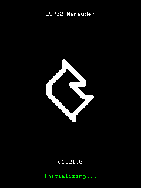

# ESP32 Marauder simulation test (2026-11-25)

Goal: run the real **ESP32 Marauder v1.21.0** firmware (CYD 2432S028 build:
ESP32-WROOM + ILI9341 240x320 SPI TFT + SD + XPT2046 touch) in the ESP32
Playground QEMU stack, with TFT video output and other components exercised.

## Firmware acquisition

Release assets are CDN-blocked from the sandbox, so `.github/workflows/
asset-relay.yml` fetches them on a GitHub runner and stages them in the
`firmware-marauder-v1.21.0` tag (run 45589796985):

- `esp32_marauder_cyd_2432S028.bin` (app, sha256 a62cf0b0…)
- `marauder-installer-assets.zip` (bootloader / partition-table / ota-data)

Merged 4MB flash image (QEMU boots raw `if=mtd`), erased-flash fill 0xFF:

| part          | offset   |
|---------------|----------|
| bootloader    | 0x01000  |
| partition-tbl | 0x08000  |
| ota-data      | 0x0e000  |
| app0 (Marauder) | 0x10000 |

## Component matrix (observed in this stack)

| component      | status | evidence |
|----------------|--------|----------|
| ROM boot + stage-2 loader | WORKS | UART: `rst:…, boot:0x12`, `load:` segments, `entry 0x400805e4` (stage-2 entry) |
| app entry / early init    | partial | GDB breakpoints reached application entry `0x40083078`, subsequent initialization and the FreeRTOS scheduler; full startup still hangs. |
| UART console  | WORKS | full boot log captured clean over the bridge |
| TFT ILI9341 (SPI2, DC=2)  | WORKS (model proven with `examples/tft_ili9341`) | pixel-perfect 240x320 render: color bars + checkerboard + 8x8 font text (`work/tft_evidence.png`) |
| GPIO / DC pin tracking    | WORKS | 13k+ GPIO level events, DC-driven command/data classification |
| WiFi / BLE / I2C / ADC / buttons / sensors | WORKS (e2e 4/4) | see docs/TESTING.md |
| SD card (SPI)             | PARTIAL | CYD SPI3/GPIO5 card initializes and reads/writes a raw sector in an ESP-IDF guest; FAT and Marauder integration remain unverified. |
| Touch (XPT2046)           | PARTIAL | Guest test reads raw coordinates, pipelined conversions and active-low IRQ level. GPIO edge interrupts and Marauder integration remain unverified. |
| ESP32 SPI DMA | PARTIAL | Descriptor-driven TX demonstrated by `examples/tft_dma_test`; descriptor TX/RX chain unit tests pass. Not a complete DMA controller; RX is not yet tested with a guest peripheral. |
| Marauder app startup      | PARTIAL / REBOOTS | Genuine initialization screen captured; Bluetooth clock assertion stops startup (see below). |

## Marauder initialization capture and remaining blockers

This is the real CYD release firmware's TFT output, captured from RGB565
rectangle messages at `ICOUNT=5` and reconstructed in the display's raw
address coordinates. It is an initialization screen, **not** evidence of a
working interactive UI. A 75-second run using a newly formatted 64 MiB FAT32
image produced 207,458 TFT rectangles and 6,010 GPIO updates, but UART still
reported `Failed to mount SD Card` followed by
`assert failed: esp_bt_controller_init bt.c:1549 (select_src_ret && set_div_ret)`
and software resets. The earlier raw-sector test image was not FAT formatted;
using a FAT32 image does not by itself resolve the Marauder mount failure.
The release binary lacks the ELF symbols required by the existing Bluetooth
hooks. Bluetooth, Wi-Fi, SD mounting and touch have not been demonstrated in
Marauder. Instruction timing affects progress; this is not a deterministic
success test.

Set `ICOUNT=5` when running `tests/marauder-smoke.mjs` to reproduce the timing
configuration used for this capture; the script reports observations rather
than declaring success.

## Earlier Marauder boot hang (documented limitation)

With the TFT, touch, and SD options enabled, a 45-second smoke run
(`node tests/marauder-smoke.mjs <merged-4mb.bin> <sd-image> 45`) reported
2,146 UART characters, **zero GPIO updates and zero TFT rectangles**, and
repeated `TG1WDT_SYS_RESET` resets. Thus none of the independent component
smoke tests establish that Marauder itself works.

The UART line `entry 0x400805e4` is the **second-stage bootloader** entry,
not the application entry. A separate GDB-remote breakpoint trace reached the
real app image entry `0x40083078`, the later CPU startup at `0x40146ab0`, and
the scheduler path at `0x40098428`, the FreeRTOS `main` task at
`0x401fe610`, Arduino `app_main` at `0x4013bee0`, and the Arduino loop task
entering its setup call at `0x40112f34` on CPU 1. Multiple intervening
breakpoints altered execution timing, so this does not establish normal
progress without the debugger, nor that display initialization completed.
A sampled post-stall PC was inside ROM eFuse code; the precise cause and the
point at which startup stops making progress remain unknown. Earlier evidence
showed the eFuse verify failure branch was not taken, so the ROM sample alone
should not be treated as a root-cause diagnosis.

## Fixes that came out of this test

1. **UART text corruption (pre-existing, now fixed):** the backend parsed
   `UART_DATA` with `subarray(1)` while the wire format is
   `u8 uart, u16 n, bytes` — the u16 length leaked `0x01 0x00` before every
   character in *all* UART output. This was the "qcall2 image has 0x01
   interleaved" mystery: an artifact of our parser, not the firmware.
2. **SPI phantom command bytes (upstream espressif-qemu bug):** the USR
   transaction path emitted the command phase when `COMMAND_BITLEN` was
   merely stale (register reset value), sending 2 zero bytes before every
   pure-data transaction. Gated on `USER.COMMAND` like real hardware.
3. **SPI bus numbering:** `object_get_canonical_path_component` returns NULL
   in `instance_init`; moved to `realize` (flash = bus 1, HSPI = bus 2).
4. **TFT model new:** ILI9341/ST7789 command parser (CASET/RASET/RAMWR/
   MADCTL/COLMOD) with DC-pin classification via the GPIO out path and
   dirty-rect `ESPPLAY_MSG_TFT_FRAME` (0x13) frames on CS deassert.

## ESP32 SPI DMA (experimental)

The ESP32 SPI model now handles DMA in/out link registers and follows guest
linked descriptors for data transfers. `examples/tft_dma_test` drives the
ILI9341 demo with ESP-IDF `spi_bus_initialize(..., 1)`; a QEMU run produced
5,735 TFT updates and the color bars/checkerboard/text image. The descriptor
walker also has host tests (`python3 tests/test_spi_dma.py`) covering chained
TX and RX, partial RX, ownership, and malformed descriptors.

This is not full hardware emulation: DMA interrupts/status and channel
arbitration are not implemented, and RX has not been verified end-to-end
against a guest peripheral. Circular/oversized chains are bounded. Marauder
still needs a successful startup and an integrated SD/touch test.

## CYD SPI SD card (experimental)

Pass `sdImage` with an existing power-of-two-sized raw SD image inside the
workspace when creating an ESP32 session. It is copied per session, so guest
writes do not alter the source and do not survive session deletion. The
CYD-compatible SPI SD card uses SPI3 and GPIO5 software chip select. Omit the
field to preserve existing behavior. Hardware-controlled CS, FAT mounting,
DMA with an SD card, and Marauder are not yet verified.

`node tests/sd-spi.mjs` (with the backend running) creates a temporary 64 MiB
image and verifies SD initialization, a sector read, a write and readback
inside an ESP-IDF guest, as well as source-image isolation.

## XPT2046 touch (experimental)

Enable a CYD touch device with session option `touch: {bus: 3, csPin: 33,
irqPin: 36}`. Send WebSocket messages `{"kind":"touch","down":true,
"x":1234,"y":3456}` (raw 0–4095 ADC units), and a message with `down:false`
to release. `node tests/touch-spi.mjs` exercises guest SPI coordinate and
pipelined pressure reads, and the active-low IRQ *level*. Pressure readings
are synthetic; GPIO interrupt delivery and real driver calibration have not
yet been verified. SPI GPIO matrix routing is not modeled, so devices sharing
a controller rely on correct software chip selects.
